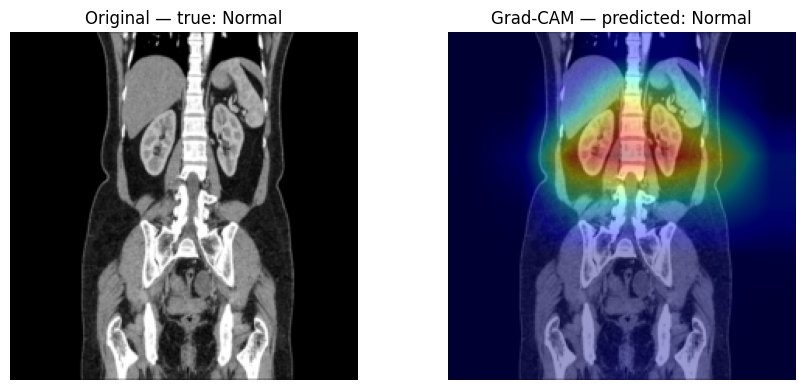
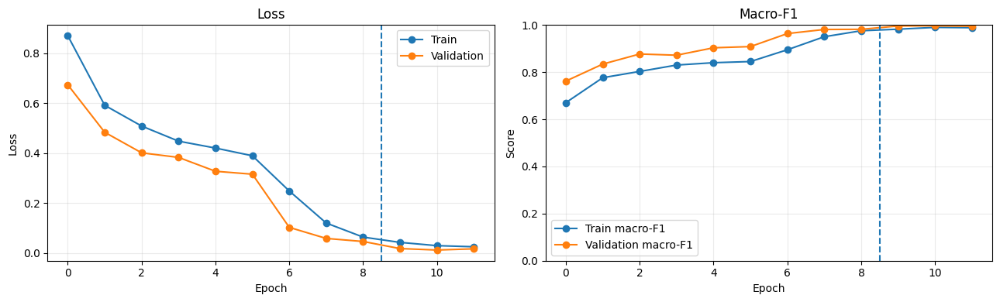

# Kidney CT Image Classification Using ResNet50 and Grad-CAM

A deep-learning research prototype that classifies kidney CT images into four categories: **Cyst, Normal, Stone, and Tumor**. The project uses transfer learning with an ImageNet-pretrained ResNet50 model, evaluates performance on a held-out test split, and uses Grad-CAM to visualize image regions that influence a prediction.

> **Research and education only.** This project is not a medical device. It must not be used to diagnose, rule out, or guide treatment of any medical condition. Its reported results do not demonstrate clinical validity.

## Project overview

The notebook is designed to run in **Kaggle Notebooks** with GPU acceleration. It automatically searches the Kaggle input directory for a dataset containing `train`, `val`, and `test` folders.

### Classification categories

- **Cyst**
- **Normal**
- **Stone**
- **Tumor**

### Workflow

1. Load and validate the train, validation, and test image folders.
2. Convert CT images to three-channel grayscale and resize them to `224 × 224` pixels.
3. Apply moderate training augmentation and ImageNet normalization.
4. Load ImageNet-pretrained ResNet50 weights.
5. Train the classification head while the backbone is frozen.
6. Fine-tune ResNet50's final `layer4` block and the classification head.
7. Evaluate on the held-out test split using accuracy, macro-F1, macro ROC-AUC, and class-wise metrics.
8. Generate a confusion matrix, training curves, and Grad-CAM visualizations.

## Dataset

The notebook run recorded the following split sizes:

| Split | Cyst | Normal | Stone | Tumor | Total |
|---|---:|---:|---:|---:|---:|
| Train | 2,596 | 3,553 | 963 | 1,598 | 8,710 |
| Validation | 741 | 1,015 | 275 | 456 | 2,487 |
| Test | 371 | 509 | 139 | 229 | 1,248 |
| **Total** | **3,708** | **5,077** | **1,377** | **2,283** | **12,445** |

The notebook detected the dataset in the Kaggle environment at a path ending in:

```text
kidney-stone-datasets/Split_Images/
    train/Cyst, Normal, Stone, Tumor/
    val/Cyst, Normal, Stone, Tumor/
    test/Cyst, Normal, Stone, Tumor/
```

Add the dataset used for the original run to your Kaggle notebook through **Add Input**. The dataset itself is not included in this repository; follow its original Kaggle page for access and licensing terms.

## Model and training configuration

| Setting | Value |
|---|---|
| Architecture | ResNet50 |
| Initial weights | ImageNet-pretrained (`IMAGENET1K_V2`) when available |
| Input size | 224 × 224 |
| Batch size | 32 |
| Optimizer | AdamW |
| Loss | Weighted cross-entropy |
| Training phases | Frozen classifier-head training, then `layer4` fine-tuning |
| Epochs configured | 6 + 6 (12 maximum across both phases) |
| Learning rates | `1e-3` for head training; `1e-5` for fine-tuning |
| GPU acceleration | CUDA and automatic mixed precision when available |

If pretrained weights cannot be downloaded in the Kaggle environment, the notebook warns and falls back to randomly initialized ResNet50 weights. This can materially affect results.

## Results recorded in the notebook

The notebook reported these metrics on its held-out test split:

| Metric | Result |
|---|---:|
| Test accuracy | **99.68%** |
| Test macro-F1 | **99.61%** |
| Test macro ROC-AUC (one-vs-rest) | **1.0000** |

### Class-wise test metrics

| Class | Precision | Recall | F1-score | Test images |
|---|---:|---:|---:|---:|
| Cyst | 99.46% | 99.73% | 99.60% | 371 |
| Normal | 99.61% | 100.00% | 99.80% | 509 |
| Stone | 100.00% | 98.56% | 99.28% | 139 |
| Tumor | 100.00% | 99.56% | 99.78% | 229 |

These are the results recorded by this particular notebook run, not a guarantee that another run or an independent dataset will produce the same performance. Review the limitations below before interpreting them.

## Visual results

### Grad-CAM example

The example below shows a test CT image whose true and predicted label was `Normal`, together with its Grad-CAM overlay.



### Training curves

The plots show training and validation loss and macro-F1 across the two training phases. The dashed vertical line marks the start of fine-tuning.



## Repository structure

```text
kidney-ct-classification-resnet50/
├── README.md
├── requirements.txt
├── .gitignore
├── notebooks/
│   └── kidney_ct_classification_resnet50.ipynb
└── assets/
    ├── gradcam-example.png
    └── training-curves.png
```

## Publish this project on GitHub

1. Create a new repository on GitHub named `kidney-ct-classification-resnet50`.
2. Extract this project ZIP on your computer.
3. Open a terminal in the extracted `kidney-ct-classification-resnet50` folder.
4. Run the following commands, replacing `<YOUR-USERNAME>` with your GitHub username:

```bash
git init
git add .
git commit -m "Initial commit: kidney CT classification with ResNet50"
git branch -M main
git remote add origin https://github.com/<YOUR-USERNAME>/kidney-ct-classification-resnet50.git
git push -u origin main
```

Do not upload the original dataset or large model checkpoint files unless you have confirmed that you are allowed to redistribute them and have chosen an appropriate way to host large files.

## Run the notebook

### Recommended: Kaggle Notebooks

1. Sign in to Kaggle and create a new notebook.
2. Upload or import `notebooks/kidney_ct_classification_resnet50.ipynb`.
3. Use **Add Input** to attach the kidney CT dataset used by the notebook.
4. Open notebook **Settings** and select a GPU accelerator (a Tesla T4 was used for the recorded run, when available).
5. Run the notebook cells from top to bottom.
6. Check the Kaggle notebook's `/kaggle/working/` output directory for the saved model and reports.

The notebook searches for `Split_Images/train`, `Split_Images/val`, and `Split_Images/test` automatically. If your dataset has a different layout, update `DATA_ROOT` in the dataset-path cell.

### Local environment

The notebook uses Kaggle-specific input/output paths and is therefore easiest to run on Kaggle. To run locally, install the packages in `requirements.txt`, change `INPUT_ROOT` and `OUTPUT_DIR` to local paths, and make sure the dataset follows the expected folder structure. Install a PyTorch build compatible with your operating system and CUDA setup by following the official PyTorch installation instructions.

## Generated outputs

After a successful run, the notebook saves the following files under `/kaggle/working/`:

- `kidney_resnet50_classifier.pth` — final PyTorch model checkpoint.
- `best_head_checkpoint.pth` and `best_finetune_checkpoint.pth` — best checkpoints from each training phase.
- `latest_head_checkpoint.pth` and `latest_finetune_checkpoint.pth` — latest checkpoints from each phase.
- `training_history.csv` — epoch-level training and validation history.
- `test_class_metrics.csv` — class-wise test precision, recall, F1, and support.
- `test_confusion_matrix.png` — test confusion matrix.
- `kidney_project_outputs.zip` — archive of the generated working-directory outputs.

Model checkpoints and the dataset are not included in this GitHub repository. The `.gitignore` excludes common dataset and model-weight files to help avoid accidentally committing large files.

## Important limitations

- **Not for clinical use:** this is an experimental image-classification pipeline, not a validated diagnostic system.
- **Patient-level data leakage:** if multiple CT slices from one patient are present, the data should be split by patient rather than by individual image. Otherwise, related slices may appear in both training and test sets and inflate test performance. The notebook does not establish that the supplied dataset was split at patient level.
- **No external validation:** a held-out test split from the same dataset does not prove that the model generalizes to other hospitals, scanners, acquisition protocols, or patient populations.
- **Class imbalance:** the Stone class has fewer examples than the other classes. Review class-wise recall and F1 rather than accuracy alone.
- **Label quality:** the source labels and consistency of image views and acquisition protocols should be independently checked.
- **Grad-CAM interpretation:** a heatmap is a visualization/debugging aid. It does not prove that the model is focusing on medically meaningful anatomy or making a clinically correct decision.
- **Scores are not calibrated clinical probabilities.**
